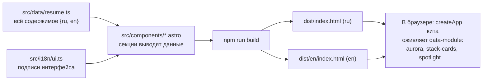

# 00. С чего начать

Этот учебник для человека, который знает HTML, CSS и немного TypeScript и хочет понять, как
собрать быстрый двуязычный сайт-резюме на **Astro** с эффектами — шейдером на первом экране,
стопкой карточек, подсветкой под курсором — так, чтобы он нормально находился поиском и работал
без JavaScript.

## Как устроена каждая глава

1. **Зачем** — что видит человек и какую задачу решаем.
2. **Как это выглядит** — маленький пример.
3. **Как это сделано здесь** — настоящий код с разбором.
4. **Ошибки** — что ломается у всех в первый раз.
5. **Попробуйте сами** — задания с ответами под спойлером.

## Картинка целиком

Три идеи:

1. **Содержимое отдельно от вёрстки.** Добавить проект — правка одного файла с данными.
2. **Два языка — две настоящие страницы**, а не переключение текста скриптом: поисковик
   индексирует обе.
3. **Эффекты — украшение.** Без WebGL, без JS, с «уменьшить движение» резюме читается так же.

## Словарь в одну строку

| Слово | Простыми словами | Пример |
| --- | --- | --- |
| **Astro** | Собирает страницы в готовый HTML, JS шлёт только туда, где нужен | весь сайт |
| **Компонент `.astro`** | Шаблон, который выполняется при сборке | `Pets.astro` |
| **`{ ru, en }`** | Текст на двух языках в одном объекте | `profile.role` |
| **`pick(text, locale)`** | Взять текст нужного языка | `pick(pet.title, locale)` |
| **`hreflang`** | Подсказка поисковику: это та же страница на другом языке | `<link rel="alternate">` |
| **`data-module`** | «Запусти на мне модуль кита» | `data-module="aurora"` |
| **Шейдер** | Программа видеокарты: цвет каждого пикселя | северное сияние |
| **fbm** | Несколько слоёв шума разного масштаба — «облачная» текстура | `aurora` |
| **Растянутая ссылка** | Ссылка, у которой `::after` накрывает всю карточку | карточка пет-проекта |
| **base** | Путь сайта в подпапке: `/resume/` на GitHub Pages | `withBase()` |

## Порядок чтения

| Если вы хотите… | Читайте |
| --- | --- |
| понять, как всё разложено | [01. Архитектура](01-architecture.md) |
| эффекты | [02. Эффекты](02-effects.md) |
| публикацию | [03. Деплой](03-deploy.md) |
| понять конкретный файл | [Разбор кода](code/README.md) |
| устройство модулей кита | [учебник frontend-kit](https://github.com/dmitriy9427/frontend-kit/blob/main/docs/learn/00-start.md) |
